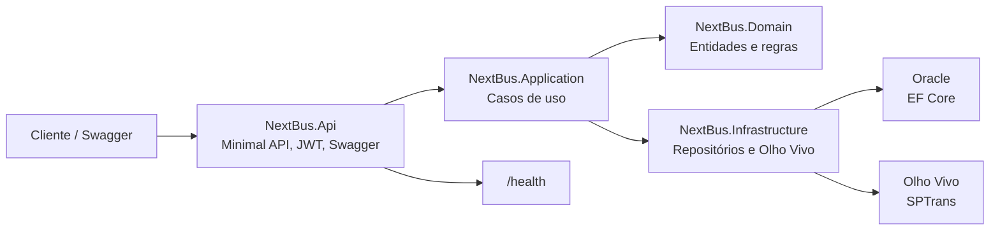

## 👥 Integrantes do Grupo (Turma 2TDSPF)
* **Enzo Vaz** - RM: 561702
* **Lucas Ryuji Fukuda** - RM: 562152
* **Pietro Donela Salomão** - RM: 561722

# 🚌 NextBus API - Global Solution 2026/2

## 📌 Descrição do Projeto

A **NextBus API** é o backend do aviso de chegada do ônibus, entrega de Advanced Business Development with .NET. Em **.NET 10** e **Clean Architecture**, ela consulta linhas, paradas e posições em São Paulo e avisa, na janela da rotina, quantos minutos faltam para o ônibus chegar no ponto. A frase do aviso é padrão: letreiro, ponto, minutos, idade do GPS e, se houver, o comunicado vigente. Sem veículo, o texto não inventa acidente, desvio nem lotação. A geração por IA fica na disciplina de Disruptive Architectures.

O aplicativo do grupo continua apontando para a API Java. Esta API repete o mesmo contrato.

## 🏗️ Arquitetura



| Camada | Responsabilidade |
|---|---|
| `NextBus.Api` | HTTP, Swagger, JWT, rate limit e health checks |
| `NextBus.Application` | Casos de uso, DTOs e contratos dos repositórios |
| `NextBus.Domain` | Entidades, exceções e a regra do aviso |
| `NextBus.Infrastructure` | Entity Framework Core (Oracle) e cliente da Olho Vivo |
| `NextBus.Domain.Tests` | Regra do aviso com xUnit, sem banco e sem HTTP |
| `NextBus.API.Tests` | Endpoints com `WebApplicationFactory` |

O endpoint não acessa o `DbContext`. Ele chama o service da Application, o service aplica a regra do Domain e o repositório concreto persiste. Erros de validação, conflito, acesso e limite passam por um tratador global e voltam como JSON `{ "titulo", "status", "erros": [{ "campo", "mensagem" }] }`. O health não usa esse formato: devolve `status` e `resultados`.

## 🚀 O que a API entrega

* **Minimal API:** cadastro, login, rotinas, avisos, linhas, paradas, posições, previsão, planejamento e o painel do gestor, com validação e códigos HTTP.
* **JWT:** `POST /auth/login` devolve o token. Leitura exige sessão. Rotina e aviso exigem o papel `CIDADAO`. O painel exige `GESTOR`.
* **Idempotência:** `POST /rotinas` exige o cabeçalho `Idempotency-Key`. A mesma chave e o mesmo corpo devolvem a rotina já criada. Outro corpo com a mesma chave responde `409`.
* **Rate limit:** linhas, paradas, posições e previsão aceitam 60 consultas por minuto. Acima disso, HTTP `429`.
* **Oracle:** Entity Framework Core no Oracle 19c da FIAP. As tabelas `USUARIO`, `ROTINA` e `AVISO` vêm do script do grupo. `SENHA` e `IDEMPOTENCIA` são criadas pela API no mesmo schema, fora desse script.
* **Olho Vivo:** linha, posição e previsão usam a SPTrans quando a autenticação responde `true`. Se falhar, a API usa um recorte local e o health marca `olhovivo` como degradado.
* **Health check:** `GET /health` confere o banco e a autenticação na Olho Vivo.
* **Testes:** xUnit da janela do aviso e dos endpoints.

### Papéis

| E-mail | Senha | Papel | O que pode fazer |
|---|---|---|---|
| `marina.costa@email.com` | `Marina#2026` | CIDADAO | Consultar, planejar, manter as próprias rotinas e ler os avisos delas |
| `ricardo.nunes@email.com` | `Ricardo#2026` | GESTOR | Consultar e ver `GET /operacao/linhas-sem-gps`. Não entra nas rotinas do cidadão |

O cadastro público cria apenas `CIDADAO`. A senha não fica na tabela `USUARIO`: o hash vai para `SENHA`. Essas contas são só de demonstração.

---

# 🛠️ Instalação e execução

## Pré-requisitos

- [.NET 10 SDK](https://dotnet.microsoft.com/download/dotnet/10.0)
- Oracle da FIAP acessível (`oracle.fiap.com.br`, porta `1521`, SID `ORCL`)

## Passo a passo

### 1. Clone

```bash
git clone https://github.com/EnzoVazz/NextBus.API
cd NextBus.API
```

### 2. Senha do Oracle e token da Olho Vivo

O host, a porta, o SID e o usuário já estão em `src/NextBus.Api/appsettings.json`. A senha fica em `src/NextBus.Api/appsettings.Local.json`, fora do git:

```json
{
  "Oracle": {
    "Password": "SUA_SENHA"
  }
}
```

O token da Olho Vivo fica na variável de ambiente `OLHOVIVO_TOKEN`, também fora do código.

### 3. Subir a API

No Rider, abra a solução `NextBus.slnx` e rode o perfil `http` do projeto `NextBus.Api`.

Na linha de comando, na pasta do projeto:

```bash
dotnet run --project src/NextBus.Api --launch-profile http
```

Swagger: `http://localhost:5218/swagger`

No Swagger, chame `POST /auth/login`, copie o campo `token` e use **Authorize** só com esse valor, sem a palavra Bearer.

### 4. Testes

```bash
dotnet test NextBus.slnx
```

Os testes de domínio não usam banco. Os testes de API usam o mesmo Oracle, entram com a Marina e o Ricardo e apagam só os usuários que eles mesmos criam. As rotinas do script permanecem.

---

# 🛣️ Endpoints

## Autenticação

`POST /auth/registrar` e `POST /auth/login` são públicos. O cadastro recebe nome, e-mail e senha e cria um `CIDADAO`. O login responde `token`, `papel` e `nome`.

`GET /auth/eu` exige sessão e devolve a pessoa autenticada.

## Health — `GET /health`

Público. Não aparece na lista do Swagger. O JSON traz `status` e `resultados`, com `banco` e `olhovivo`. Com a Olho Vivo autenticada, os dois ficam `Healthy`. Se `POST /Login/Autenticar` responder `false`, `olhovivo` fica `Degraded` e a API continua no ar.

## Consulta

Exige sessão. Limite de 60 por minuto.

| Rota | O que devolve |
|---|---|
| `GET /linhas?q=` | Linhas pelo número ou pelo nome |
| `GET /paradas/proximas?lat=&lng=` | Paradas do recorte local perto de uma coordenada |
| `GET /linhas/{codigo}/posicoes` | Posição dos ônibus, com letreiro, sentido, acessibilidade e idade do GPS |
| `GET /previsao?parada=&linha=` | Previsão da parada e da linha |

Com a Olho Vivo autenticada, linha, posição e previsão vêm da SPTrans e ficam em cache por 15 segundos. `GET /paradas/proximas` continua no recorte local.

## Planejamento — `POST /viagens/planejar`

Papel `CIDADAO`. Devolve até três viagens diretas entre a origem e o endereço de destino, sem baldeação. O recorte cobre a linha `7021-10`, a parada Roberto Selmi Dei e o Jardim Maracá. Um endereço fora da lista responde `400`.

## Rotinas — `/rotinas`

Papel `CIDADAO`, só nas rotinas da pessoa autenticada. `GET`, `POST`, `PUT` e `DELETE`.

`POST /rotinas` exige `Idempotency-Key`. Sem a chave, responde `400`. A mesma chave e o mesmo corpo respondem `200` com a rotina já criada. Outro corpo na mesma chave responde `409`.

Os dias entram como `SEG`, `TER`, `QUA`, `QUI`, `SEX`, `SAB` e `DOM` e ficam gravados como `1` (segunda) a `7` (domingo). `ativa` omitida nasce ligada. No Oracle, `ativa` fica `S` ou `N`.

## Avisos — `GET /avisos`

Papel `CIDADAO`. Calcula os avisos do dia das rotinas da pessoa.

Vinte minutos antes do horário, a rotina entra na janela. Entre os ônibus que ainda vão chegar, fica o de previsão mais perto do horário. O acompanhamento gruda no prefixo daquele dia. A primeira frase sai com no máximo 15 minutos e a mesma notificação atualiza ao cruzar 10, 5 e 2. Em zero, ou se o veículo sai da previsão, o aviso encerra. Sem veículo na janela, sai uma vez a frase sem número.

## Operação — `GET /operacao/linhas-sem-gps`

Papel `GESTOR`. Lista linhas cujo GPS mais recente passou de três minutos. No recorte local, a linha `8000-10` entra nesse painel. Um cidadão recebe `403`.

---

# 📌 Status codes

| Status | Quando |
|---|---|
| `200 OK` | Consulta, login ou repetição da mesma `Idempotency-Key` |
| `201 Created` | Cadastro de cidadão ou de rotina |
| `204 No Content` | Exclusão da rotina |
| `400 Bad Request` | Validação ou `Idempotency-Key` ausente |
| `401 Unauthorized` | Sem token ou credencial inválida |
| `403 Forbidden` | Token válido sem o papel exigido |
| `404 Not Found` | Rotina inexistente ou de outra pessoa |
| `409 Conflict` | Mesma chave com outro corpo, ou rotina ativa duplicada |
| `429 Too Many Requests` | Limite de consultas atingido |
